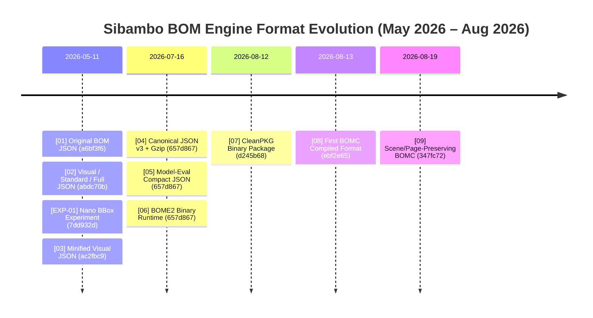

# Sibambo BOM Engine — Complete Format Evolution & Archaeology Report

**Date**: 2026-08-19  
**Authors**: Sibambo Research Team (Ridwan Ilyas & Kais Abiyyi)  
**Scope**: Historical format lineage spanning repository origin (`rdwnilyas-coder/sibambo-bom-engine`) to current production (`KaisAbiyyi/sibambo-bom-engine-plugin`).

---

## 1. Executive Summary

Before transitioning BOMC into Sibambo's primary authoring format, this archaeology establishes a complete, immutable, and reproducible baseline of every significant BOM Engine exporter generation.

All 10 selected historical engines have been isolated under dedicated Ruby namespaces (`SibamboHistory::V*`) and packaged into a single side-by-side SketchUp extension: **Sibambo BOM Engine Evolution Lab**, coexisting seamlessly with the current production BOM Engine.

---

## 2. Verified Historical Timeline



| Seq | Display Version | Date | Label | Repository | Commit SHA | Format Family | Output Ext | Compression | Classification |
| :--- | :--- | :--- | :--- | :--- | :--- | :--- | :--- | :--- | :--- |
| **01** | `SBE-2026.05.11-01` | 2026-05-11 | Original BOM JSON | `rdwnilyas-coder` | `a6bf3f638e38` | `bom_json_v2` | `.json` | None | `MAJOR` |
| **02** | `SBE-2026.05.11-02` | 2026-05-11 | Visual / Standard / Full JSON | `rdwnilyas-coder` | `abdc70bbfd17` | `bom_json_v2_multilevel` | `.json` | None | `RELEASE` |
| **03** | `SBE-2026.05.11-EXP` | 2026-05-11 | Nano BBox JSON | `rdwnilyas-coder` | `7dd932dfe1b7` | `bom_nano_json` | `_nano.json` | None | `EXPERIMENT` |
| **04** | `SBE-2026.05.11-03` | 2026-05-11 | Minified Visual JSON | `rdwnilyas-coder` | `ac2fbc983cee` | `bom_json_v2_minified` | `_visual.json` | None | `RELEASE` |
| **05** | `SBE-2026.07.16-01` | 2026-07-16 | Canonical JSON v3 + Gzip | `KaisAbiyyi` | `657d8671a66a` | `canonical_json_v3` | `_canonical.json.gz` | Gzip (optional) | `MAJOR` |
| **06** | `SBE-2026.07.16-02` | 2026-07-16 | Model-Eval Compact JSON | `KaisAbiyyi` | `657d8671a66a` | `model_eval_json_v1` | `_model-eval.json` | None | `RELEASE` |
| **07** | `SBE-2026.07.16-03` | 2026-07-16 | BOME2 Binary Runtime | `KaisAbiyyi` | `657d8671a66a` | `bome2_runtime_v2` | `_runtime.bome2` | Gzip (optional) | `MAJOR` |
| **08** | `SBE-2026.08.12-01` | 2026-08-12 | CleanPKG Binary Container | `KaisAbiyyi` | `d245b6873a99` | `clean_package_v1` | `.cleanpkg` | Zip Deflate | `MAJOR` |
| **09** | `SBE-2026.08.13-01` | 2026-08-13 | First BOMC Compiled Format | `KaisAbiyyi` | `ebf2e658a790` | `bomc_compiled_v1_0` | `.bomc` | Section Deflate | `MAJOR` |
| **10** | `SBE-2026.08.19-01` | 2026-08-19 | Scene/Page-Preserving BOMC | `KaisAbiyyi` | `347fc7247fde` | `bomc_compiled_v1_1_scenes` | `.bomc` | Section Deflate | `MAJOR` |

---

## 3. Detailed Special Lineage Analysis

### 3.1. First JSON Exporter & 3-Level Tiering
- **Commit**: `a6bf3f638e387f52a6e32bf4aea7f635b9ad2225` (2026-05-11 11:14:50 +07:00)
- **Concept**: Emitted a monolithic recursive world-space entity tree with AHSP material metadata, spatial analysis, and camera info.
- **Limitation**: Large buildings generated 50–100 MB JSON files, causing browser crashes during JSON parsing.
- **3-Level Solution (`abdc70bb`)**: Introduced `Visual` (~5–8 MB, surface geometry only), `Standard` (~15–20 MB), and `Full BIM` (~47 MB).
- **Minified Default (`ac2fbc98`)**: Made non-pretty minified JSON the default, cutting size by 2–3x.

### 3.2. Nano BBox Experiment (Experiment Milestone)
- **Commit**: `7dd932dfe1b7eeb500e9d82e2d87fbe2275f56be` (2026-05-11 16:31:19 +07:00)
- **Concept**: Stripped all polygon face geometry, exporting only Axis-Aligned Bounding Boxes (AABB) classified by architectural category (`wall`, `kolom`, `balok`, `atap`, `pondasi`) to achieve $< 1\text{ MB}$ payload.
- **Fate**: Removed in commit `6680034a` because bounding boxes lacked visual fidelity for architectural presentations, but preserved in Evolution Lab as a historical experiment.

### 3.3. Canonical JSON v3 & Gzip Timeline
- **Commit**: `657d8671a66a78d643935d891e5c8b07154b8948` (2026-07-16 19:43:47 +07:00)
- **Paradigm Shift**: Moved from flat world-space entity trees to a shared **Definition-Instance Directed Acyclic Graph (DAG)**. Repeated components (doors, windows, columns) are defined once in local space and referenced by 4x4 transformation matrices.
- **Gzip Support**: Introduced in `core.rb` via `Zlib::GzipWriter` with `compress_output: true` (`.json.gz`), achieving 85–90% compression over uncompressed JSON.

### 3.4. Compact JSON Identity ("JSON lagi tapi sangat compressed")
- **Archaeology Verdict**: The user's remembered "JSON lagi tapi sangat compressed" corresponds to **Model-Eval JSON v1.0** (`model_eval_json_writer.rb` / `compact_mesh_builder.rb`), introduced in `657d8671a66a`.
- **Structure**: Uses indexed flat coordinate arrays with coordinate quantization scaling, integer face arrays, and a deduplicated string dictionary, producing a single lightweight `_model-eval.json` file.

### 3.5. BOME1 vs. BOME2 Verdict
- **BOME1 Verdict**: Internal transitional format (`binary_mesh_writer.rb` writing `MAGIC = "BOME1\n"`) with flat `Int32Array` positions and face loops. Never widely shipped standalone.
- **BOME2 Verdict**: Shipped production binary format (`bome2_writer.rb` writing `MAGIC = "BOME2\n"`), featuring little-endian 6-field headers, CRC32 checks, axis-quantized `uint16`/`uint32` positions, and dedicated polygon/triangle/transform sections.

### 3.6. CleanPKG Verdict (Archaeology Proof)
- **Question**: Was CleanPKG emitted by SketchUp BOM Engine?
- **Archaeology Verdict**: **YES**. CleanPKG was developed on branch `origin/feature/clean-json-export` from 2026-08-09 to 2026-08-12.
- **Decisive Commit**: `d245b6873a992c87f7647c6b816c13e6ab7815e0` ("Add optimized Clean binary package export").
- **Structure**: Emitted `.cleanpkg` files, which are deterministic ZIP archives containing:
  - `manifest.json`: Hierarchical scene graph and material bindings.
  - `buffers.bin`: Packed binary vertex buffers and topological polygon/edge tables.
  - `assets/tex-<hash>.webp`: Deduplicated portable texture assets.

### 3.7. BOMC Compiled Building Format Lineage
- **First BOMC Commit**: `ebf2e658a790fc401265d20d899082b05ff18cb1` (2026-08-13 21:21:47 +07:00).
- **Core Innovation**: Replaced multi-file ZIP containers with a zero-copy single-file binary container (`BOMC\x01\x00\x00\x00`) with a 24-section table, varint codecs, octahedral normal packing, and embedded WebP textures.
- **Scene/Page BOMC Commit**: `347fc7247fdec4041ffb9ee81226b271b5044b3a` (2026-08-19 00:12:45 +07:00).
- **Advancement**: Added `SECTION_SCENES = 19`, capturing SketchUp Page persistent IDs (`stableBomcId`), tag visibility bitsets, per-scene drawing element overrides, and deterministic `visibilitySignature` hashes.

---

## 4. Architectural Comparison Table

| Dimension | [01] Original JSON | [04] Canonical v3 | [06] BOME2 | [07] CleanPKG | [08] First BOMC | [09] Scene BOMC |
| :--- | :--- | :--- | :--- | :--- | :--- | :--- |
| **Container** | Plain JSON | Plain / Gzip JSON | Binary + Sections | Deterministic ZIP | Single-File Binary | Single-File Binary |
| **Instance Reuse** | None (Expanded) | Shared DAG | Shared DAG | Shared DAG | Shared Table | Shared Table |
| **Positions** | Float (Meters) | Float (Meters) | Quantized uint16/32 | Varint Delta | Varint Quantized | Varint Quantized |
| **Normals** | None | Triangle Mesh | None | Packed Int8 | Octahedral (2 bytes) | Octahedral (2 bytes) |
| **Textures** | Folder on Disk | Folder on Disk | None | Zip Assets | Embedded Section | Embedded Section |
| **Scenes** | Camera Only | Camera Only | Camera Only | Camera Only | Camera Only | Full Tag/Node Visibility |
| **Zero-Copy Web** | No (JSON.parse) | No (JSON.parse) | Partial (TypedArray) | No (JSZip decode) | Full (TypedArray slice) | Full (TypedArray slice) |

---

## 5. Evolution Lab Extension Architecture

```
Extensions
  └─ Sibambo BOM Engine Evolution Lab
       ├─ Major & Release Versions
       │    ├─ [01] 2026-05-11 — Original BOM JSON
       │    ├─ [02] 2026-05-11 — Visual / Standard / Full JSON
       │    ├─ [03] 2026-05-11 — Minified Visual JSON
       │    ├─ [04] 2026-07-16 — Canonical JSON v3 + Gzip
       │    ├─ [05] 2026-07-16 — Model-Eval Compact JSON
       │    ├─ [06] 2026-07-16 — BOME2 Binary Runtime
       │    ├─ [07] 2026-08-12 — CleanPKG Binary Container
       │    ├─ [08] 2026-08-13 — First BOMC Compiled Format
       │    └─ [09] 2026-08-19 — Scene/Page-Preserving BOMC
       ├─ Experiments
       │    └─ [EXP-01] 2026-05-11 — Nano BBox JSON
       └─ About Evolution Lab
```

- **Top = Oldest, Bottom = Newest**: Guaranteed by chronological manifest insertion order.
- **Ruby Namespace Isolation**: Every version operates in `module SibamboHistory::V<version_key>`.
- **Zero Collision**: Preferences use `Sibambo_History_<key>_Settings`; output files append `__<version_id>` tags.
- **Production Plugin Unaffected**: Current production BOM Engine runs independently side-by-side.
